<div align="center">

# Inlustre

**Quadro de desenho com traço à mão, pronto para usar dentro do Claude e do Codex.**

Formas, setas, lápis, texto e imagens em um único arquivo HTML. Instale com um comando e a ferramenta é gerada na hora.

[](https://github.com/carlos-dataengineer/inlustre/actions/workflows/ci.yml)
[](LICENSE)
[](CHANGELOG.md)


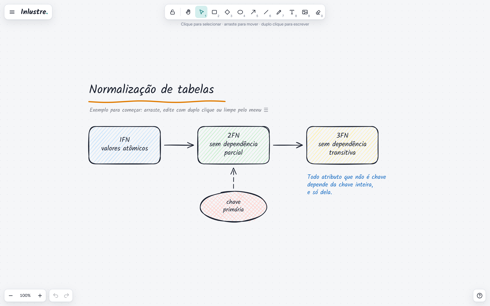

</div>

---

## Sumário

- [O que é](#o-que-é)
- [Instalação em um comando](#instalação-em-um-comando)
- [O que acontece quando você instala](#o-que-acontece-quando-você-instala)
- [Outras formas de instalar](#outras-formas-de-instalar)
- [Como usar no Claude e no Codex](#como-usar-no-claude-e-no-codex)
- [Tour pela interface](#tour-pela-interface)
- [Casos de uso](#casos-de-uso)
- [Atalhos do teclado](#atalhos-do-teclado)
- [Dicas de uso](#dicas-de-uso)
- [Salvar, exportar e compartilhar](#salvar-exportar-e-compartilhar)
- [Privacidade](#privacidade)
- [Perguntas frequentes](#perguntas-frequentes)
- [Desinstalar](#desinstalar)
- [Estrutura do repositório](#estrutura-do-repositório)
- [Desenvolvimento](#desenvolvimento)
- [Contribuir](#contribuir) · [Segurança](#segurança) · [Licença](#licença)

---

## O que é

O Inlustre é um quadro branco para desenhar ideias com aparência de rascunho feito à mão. Serve para explicar uma arquitetura em reunião, montar um exemplo em aula, organizar um brainstorm ou esboçar uma tela antes de programar.

Ele vem empacotado como **skill** para agentes de IA. Depois de instalado, basta pedir "abrir o Inlustre":

- no **Claude**, a ferramenta vira um **artefato** seu, com link próprio;
- no **Codex** (ou no terminal), ela abre direto no navegador.

| | |
|---|---|
| **Um arquivo só** | Todo o Inlustre cabe em um HTML de cerca de 110 KB, com o motor de desenho embutido. Funciona sem servidor e sem instalar nada além da skill. |
| **Traço à mão** | Retângulos, losangos, elipses, setas, linhas e lápis com três níveis de "rabisco", hachura e cantos arredondados. |
| **Texto de verdade** | Texto solto ou dentro das formas, em três fontes (manuscrita, normal e código) e quatro tamanhos. |
| **Tema claro e escuro** | Segue o tema do sistema ou do Claude, e as cores se ajustam sozinhas. |
| **Desenho pronto pelo agente** | Peça "desenhe meu pipeline no Inlustre" e o agente entrega o quadro já desenhado, editável. |
| **Seus dados com você** | Nada é enviado para servidores. O desenho fica salvo no seu navegador e sai em JSON ou PNG quando você quiser. |

---

## Instalação em um comando

**Windows (PowerShell)**

```powershell
irm https://raw.githubusercontent.com/carlos-dataengineer/inlustre/main/install.ps1 | iex
```

**macOS e Linux (terminal)**

```bash
curl -fsSL https://raw.githubusercontent.com/carlos-dataengineer/inlustre/main/install.sh | bash
```

Pronto. Ao terminar, o Inlustre já abre no seu navegador, e o Claude Code e o Codex passam a reconhecer o pedido "abrir o Inlustre" na próxima conversa.

> **Prefere ler antes de rodar?** É uma boa prática com qualquer script da internet. Abra [`install.ps1`](install.ps1) ou [`install.sh`](install.sh): são curtos, comentados e só copiam arquivos para as pastas listadas abaixo.

---

## O que acontece quando você instala

O instalador faz três coisas, nesta ordem:

1. **Baixa** o Inlustre deste repositório. Se você rodar o script de dentro de um clone, ele usa os arquivos locais.
2. **Instala a skill `inlustre`** onde os agentes procuram:

   | Agente | Pasta |
   |---|---|
   | Claude Code | `~/.claude/skills/inlustre` |
   | Codex | `~/.codex/skills/inlustre` (ou `$CODEX_HOME/skills/inlustre`) |
   | Pasta compartilhada entre agentes | `~/.agents/skills/inlustre` |

3. **Gera a ferramenta automaticamente** em `~/Inlustre/inlustre.html` e abre no navegador padrão. Você já pode desenhar, mesmo antes de abrir o Claude ou o Codex.

Depois disso, a primeira vez que você pedir o Inlustre a um agente:

- **no Claude** com artefatos (app desktop do Claude Code, claude.ai), a skill publica a ferramenta como **artefato** na sua conta e devolve o link. Nas próximas vezes, ela oferece abrir o mesmo artefato em vez de criar outro;
- **no Codex** ou no Claude Code pelo terminal, a skill abre `~/Inlustre/inlustre.html` no navegador.

> **Por que o artefato nasce no primeiro pedido, e não durante a instalação?** Um artefato pertence à sua conta do Claude e só pode ser criado de dentro de uma conversa sua. O script de instalação roda no seu computador, fora do Claude. Por isso ele gera a versão local na hora, e o artefato é publicado assim que você pede.

**Opções do instalador**

| Windows | macOS / Linux | Efeito |
|---|---|---|
| `-NoOpen` | `--no-open` | Não abre o navegador no fim |
| `-SkipClaude` | `--skip-claude` | Não instala no Claude Code |
| `-SkipCodex` | `--skip-codex` | Não instala no Codex |
| `-Ref v1.0.0` | `--ref v1.0.0` | Instala uma versão específica |

Com o comando de uma linha não dá para passar parâmetros, então use variáveis de ambiente: `INLUSTRE_NO_OPEN=1`, `INLUSTRE_SKIP_CLAUDE=1`, `INLUSTRE_SKIP_CODEX=1`, `INLUSTRE_REF=v1.0.0`.

```powershell
$env:INLUSTRE_SKIP_CODEX = '1'; irm https://raw.githubusercontent.com/carlos-dataengineer/inlustre/main/install.ps1 | iex
```

---

## Outras formas de instalar

<details>
<summary><b>Plugin do Claude Code (pelo marketplace)</b></summary>

Dentro do Claude Code:

```text
/plugin marketplace add carlos-dataengineer/inlustre
/plugin install inlustre@inlustre
```

O plugin traz a mesma skill. Atualize depois com `/plugin marketplace update inlustre`.
</details>

<details>
<summary><b>claude.ai (navegador ou app)</b></summary>

1. Baixe `inlustre-skill.zip` na página de [Releases](https://github.com/carlos-dataengineer/inlustre/releases).
2. No claude.ai, abra **Configurações → Capacidades → Skills** e envie o arquivo.
3. Em uma conversa, peça "abrir o Inlustre".
</details>

<details>
<summary><b>Sem agente nenhum</b></summary>

Baixe [`app/index.html`](app/index.html) e abra no navegador. É a ferramenta completa.
</details>

<details>
<summary><b>Manual, a partir de um clone</b></summary>

```bash
git clone https://github.com/carlos-dataengineer/inlustre.git
cd inlustre
./install.sh            # macOS / Linux
.\install.ps1           # Windows
```
</details>

---

## Como usar no Claude e no Codex

Abra uma **nova conversa** depois de instalar e peça com suas palavras:

| Você diz | O agente faz |
|---|---|
| "abrir o Inlustre" ou `/inlustre` (Claude Code) | Publica o artefato (Claude) ou abre no navegador (Codex) |
| `$inlustre` (Codex) | Abre o Inlustre no navegador |
| "quero um quadro branco para rascunhar" | Reconhece o pedido e oferece o Inlustre |
| "desenhe no Inlustre o fluxo de aprovação de férias" | Entrega o quadro já desenhado, pronto para editar |
| "monte no Inlustre uma tabela de exemplo para explicar a 2FN" | Desenha a tabela com as chaves destacadas |

**Quadro já desenhado.** Quando você pede um desenho, o agente monta os elementos em JSON seguindo [`FORMATO-QUADRO.md`](skills/inlustre/references/FORMATO-QUADRO.md) e abre o Inlustre com esse conteúdo. Todo elemento continua editável: você move, recolore e completa à mão. As imagens de [Casos de uso](#casos-de-uso) foram geradas assim.

---

## Tour pela interface

### Barra de ferramentas

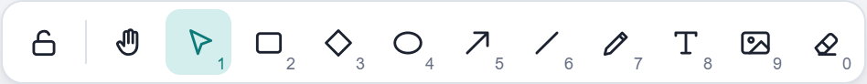

| Ícone | Ferramenta | O que faz |
|---|---|---|
| 🔓 | Manter ativa | Com o cadeado fechado, a ferramenta continua selecionada depois de desenhar |
| ✋ | Mão | Arrasta o quadro |
| ↖ | Selecionar | Seleciona, move, redimensiona e edita |
| ▭ ◇ ◯ | Formas | Retângulo, losango e elipse |
| ↗ ╱ | Seta e linha | Ligações entre formas, com pontas configuráveis |
| ✎ | Lápis | Desenho à mão livre |
| T | Texto | Clique e escreva |
| 🖼 | Imagem | Insere uma imagem do computador |
| ⌫ | Borracha | Passe sobre os elementos para apagar |

Logo abaixo da barra aparece uma dica sobre a ferramenta ativa.

### Painel de estilo

<table>
<tr>
<td width="260">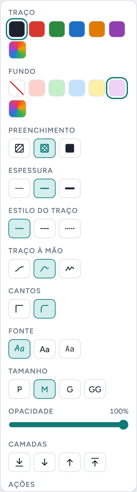</td>
<td>

O painel aparece quando você escolhe uma ferramenta de desenho ou seleciona algo. Ele mostra só as opções que valem para o que está selecionado.

- **Traço** e **Fundo**: cinco cores que se ajustam ao tema, mais uma cor livre
- **Preenchimento**: hachura, hachura cruzada ou sólido
- **Espessura**: fina, média ou grossa
- **Estilo do traço**: contínuo, tracejado ou pontilhado
- **Traço à mão**: preciso, esboço ou rabisco
- **Cantos**: retos ou arredondados
- **Pontas da seta**: no início, no fim ou nos dois lados
- **Fonte**: manuscrita, normal ou código
- **Tamanho**: P, M, G e GG
- **Alinhamento** do texto
- **Opacidade**
- **Camadas**: trazer para frente ou enviar para trás
- **Alinhar** vários elementos entre si
- **Ações**: duplicar e excluir

</td>
</tr>
</table>

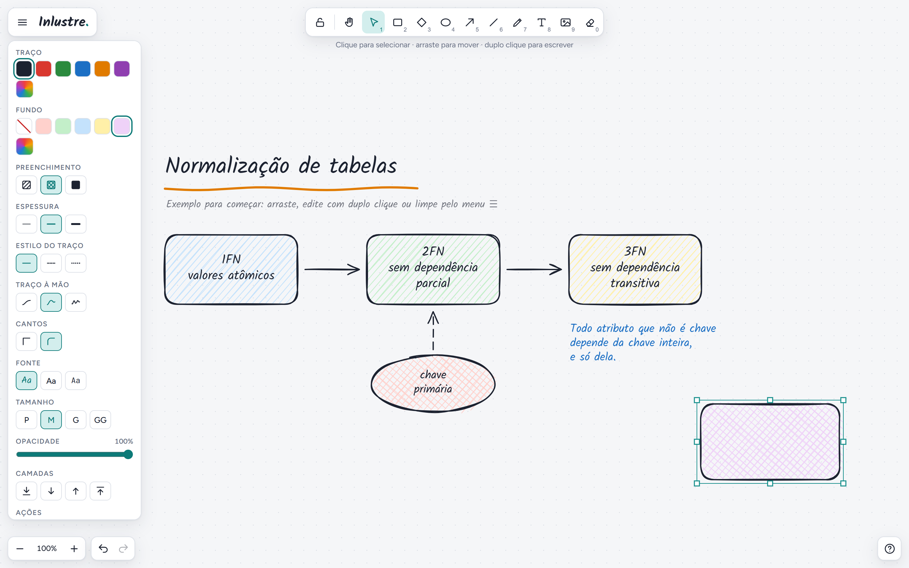

### Menu

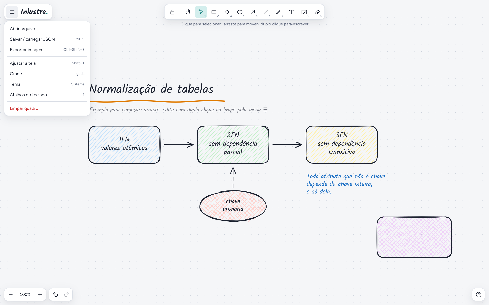

| Item | Para quê |
|---|---|
| Abrir arquivo… | Carrega um quadro salvo em `.json` |
| Salvar / carregar JSON | Copia o quadro como texto ou cola um quadro salvo |
| Exportar imagem | Gera um PNG do quadro inteiro ou só da seleção |
| Ajustar à tela | Enquadra todo o desenho |
| Grade | Liga ou desliga os pontos de fundo |
| Tema | Alterna entre sistema, claro e escuro |
| Atalhos do teclado | Mostra a lista de atalhos |
| Limpar quadro | Apaga tudo. Dá para desfazer com Ctrl+Z. |

### Exportar imagem

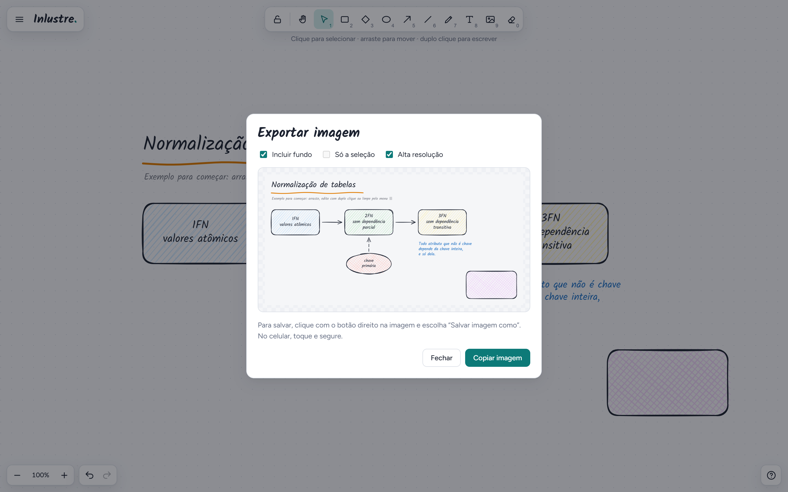

Escolha se quer o fundo, só a seleção e alta resolução (2×). Depois clique em **Copiar imagem** ou use o botão direito na prévia e **Salvar imagem como**.

### Tema escuro

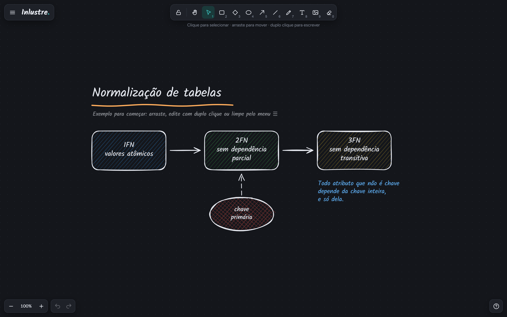

### No celular

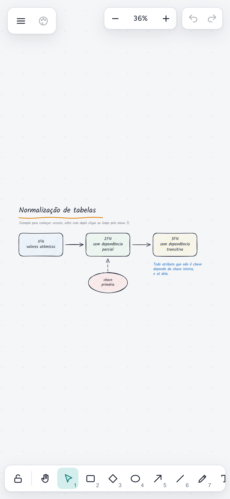

No celular, a barra de ferramentas desce para a parte de baixo e o painel de estilo abre pelo botão de paleta. Use um dedo para desenhar e dois para mover e dar zoom.

---

## Casos de uso

### Arquitetura de dados

Desenhe pipelines, camadas e pontos de decisão para alinhar o time antes de construir.

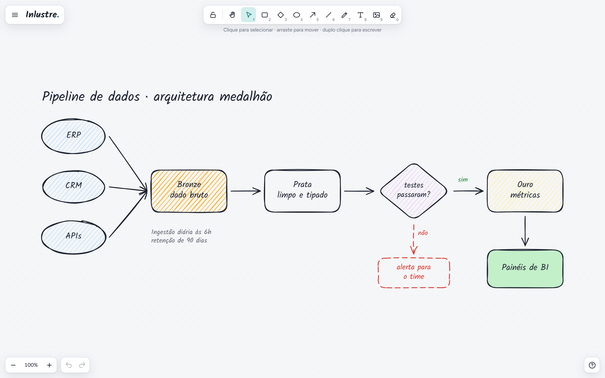

### Aula e explicação

Monte exemplos ao vivo com tabelas, chaves e anotações, como em uma lousa.

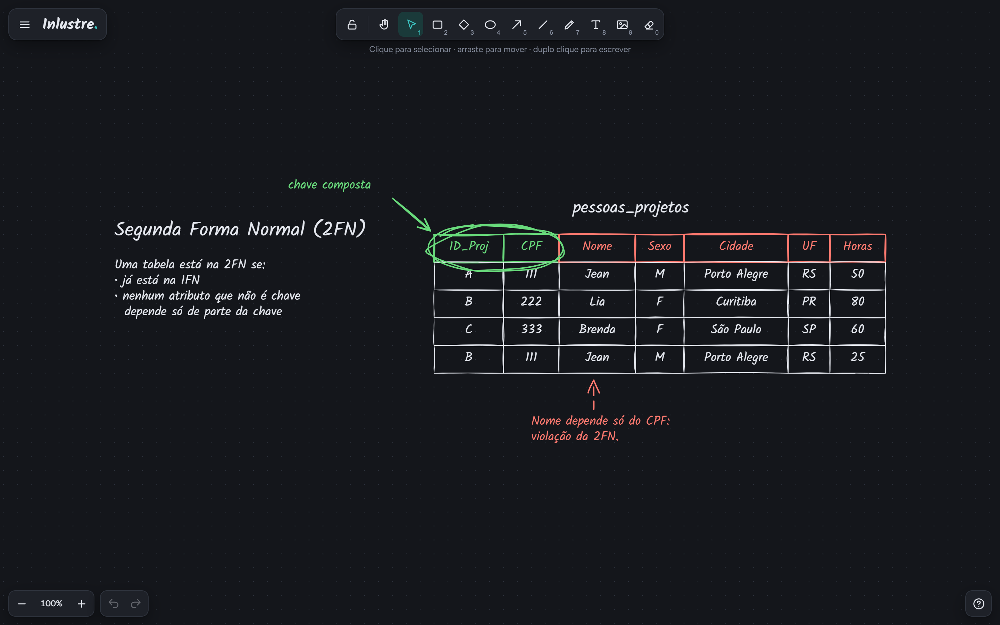

### Brainstorm e mapa de ideias

Agrupe ideias por cor, ligue ao tema central e destaque prioridades à mão.

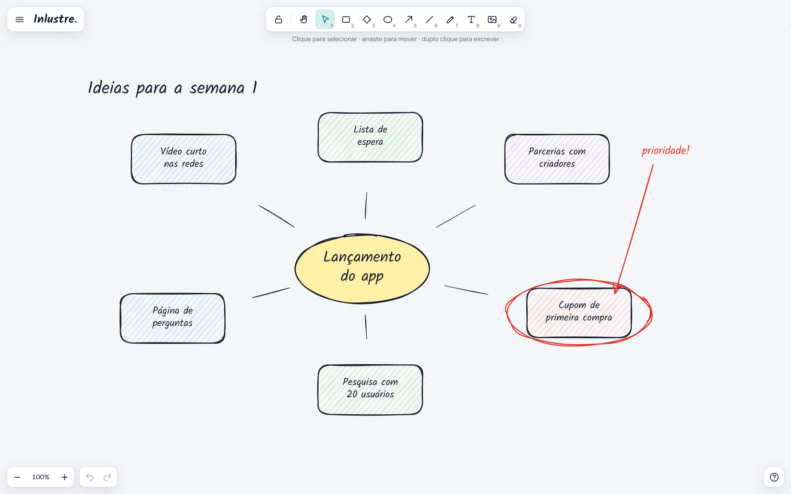

### Wireframe de tela

Esboce telas e fluxos com anotações antes de abrir a ferramenta de design.

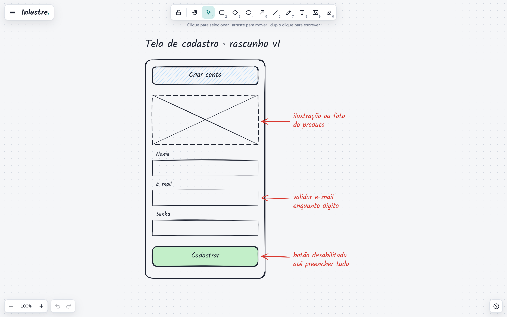

**Outras ideias:** retrospectiva da sprint, diagrama de sequência simplificado, organograma, mapa de jornada do cliente, plano de estudos, anotação sobre um print colado (Ctrl+V).

---

## Atalhos do teclado

### Ferramentas

| Tecla | Ferramenta |
|---|---|
| `V` ou `1` | Selecionar |
| `R` ou `2` | Retângulo |
| `D` ou `3` | Losango |
| `O` ou `4` | Elipse |
| `A` ou `5` | Seta |
| `L` ou `6` | Linha |
| `P` ou `7` | Lápis |
| `T` ou `8` | Texto |
| `9` | Inserir imagem |
| `E` ou `0` | Borracha |
| `H` ou segurar `Espaço` | Mover o quadro |
| `Q` | Manter a ferramenta ativa |

### Edição

| Atalho | Ação |
|---|---|
| `Ctrl` `Z` | Desfazer |
| `Ctrl` `Shift` `Z` ou `Ctrl` `Y` | Refazer |
| `Ctrl` `C` / `Ctrl` `X` / `Ctrl` `V` | Copiar, recortar e colar |
| `Ctrl` `D` | Duplicar |
| `Ctrl` `A` | Selecionar tudo |
| `Delete` ou `Backspace` | Excluir |
| Setas / `Shift` + setas | Mover 1 px / 10 px |
| `Enter` | Editar o texto do elemento selecionado |
| `Esc` | Concluir o texto, limpar a seleção ou voltar à seleção |

### Visão

| Atalho | Ação |
|---|---|
| `Ctrl` + roda do mouse | Zoom no ponto do cursor |
| Roda / `Shift` + roda | Rolar na vertical / horizontal |
| `Ctrl` `+` / `Ctrl` `−` / `Ctrl` `0` | Aumentar, diminuir e voltar a 100% |
| `Shift` `1` | Ajustar à tela |
| `G` | Ligar ou desligar a grade |
| `?` | Mostrar os atalhos |

### Arquivo

| Atalho | Ação |
|---|---|
| `Ctrl` `S` | Salvar / carregar JSON |
| `Ctrl` `Shift` `E` | Exportar imagem |

No macOS, use `Cmd` no lugar de `Ctrl`.

---

## Dicas de uso

- **Escrever dentro de uma forma:** duplo clique na forma. Para texto solto, duplo clique no espaço vazio.
- **Proporção exata:** segure `Shift` ao desenhar para fazer quadrados e círculos. Em setas e linhas, o `Shift` trava o ângulo de 15 em 15 graus.
- **Duplicar arrastando:** segure `Alt` e arraste um elemento.
- **Seleção múltipla:** `Shift` + clique, ou arraste uma caixa no espaço vazio.
- **Mudar a ponta de uma seta:** selecione a seta e arraste as bolinhas das pontas.
- **Redimensionar:** use os quadradinhos nos cantos. Texto e imagem mantêm a proporção, e o `Shift` mantém a proporção de qualquer forma.
- **Colar imagens e texto:** `Ctrl` `V` cola um print ou um texto copiado de outro lugar.
- **Arrastar arquivos:** solte uma imagem ou um `.json` do Inlustre sobre o quadro.
- **Estilo padrão:** a cor e a espessura escolhidas antes de desenhar valem para os próximos elementos.

---

## Salvar, exportar e compartilhar

| Quero… | Como |
|---|---|
| Continuar depois | Não precisa fazer nada. O quadro é salvo sozinho no navegador. |
| Guardar uma cópia | ☰ → **Salvar / carregar JSON** → **Copiar**, e cole num arquivo `.json` |
| Abrir uma cópia | ☰ → **Abrir arquivo…**, arraste o `.json` para o quadro, ou cole o texto e clique em **Carregar** |
| Mandar para alguém | Exporte o PNG, ou envie o `.json` para a pessoa abrir no Inlustre dela |
| Pôr numa apresentação | ☰ → **Exportar imagem**, com **Alta resolução** marcada |

O formato do `.json` está documentado em [`FORMATO-QUADRO.md`](skills/inlustre/references/FORMATO-QUADRO.md).

---

## Privacidade

- O Inlustre **não envia seus desenhos para lugar nenhum**. Não tem servidor, conta, telemetria nem análise de uso.
- O desenho fica no `localStorage` do navegador, separado por artefato ou por arquivo. Limpar os dados do navegador apaga o quadro, então exporte em JSON o que quiser guardar.
- A única requisição externa é a das fontes do Google Fonts (Kalam, Figtree e JetBrains Mono). Sem internet, o Inlustre usa as fontes do sistema.
- Imagens inseridas viram parte do quadro e são reduzidas para no máximo 1600 px, para caber no armazenamento do navegador.

---

## Perguntas frequentes

<details>
<summary><b>Instalei, mas o agente não reconhece o Inlustre.</b></summary>

Abra uma **nova conversa**: as skills são lidas quando a conversa começa. No Claude Code, digite `/inlustre`. Confira também se a pasta da skill existe (veja [O que acontece quando você instala](#o-que-acontece-quando-você-instala)).
</details>

<details>
<summary><b>Os desenhos aparecem para outras pessoas que abrem meu artefato?</b></summary>

Não. Cada pessoa vê o próprio desenho, salvo no navegador dela. Para mostrar o seu, exporte o PNG ou envie o JSON.
</details>

<details>
<summary><b>Posso usar sem internet?</b></summary>

Sim. Abra `~/Inlustre/inlustre.html` ou `app/index.html`. Sem internet, só as fontes mudam para as do sistema.
</details>

<details>
<summary><b>Rodar o instalador de novo apaga meus desenhos?</b></summary>

Não. O instalador só substitui os arquivos da ferramenta. Os desenhos ficam no navegador, que não é tocado.
</details>

<details>
<summary><b>Como atualizo?</b></summary>

Rode o mesmo comando de instalação. Ele substitui a versão anterior.
</details>

<details>
<summary><b>O instalador apaga alguma coisa minha?</b></summary>

Só a pasta da própria skill, e apenas se o `SKILL.md` dela se chamar `inlustre`. Se encontrar uma pasta diferente com o mesmo nome, ele avisa e pula.
</details>

<details>
<summary><b>O Inlustre roda no Windows PowerShell 5.1?</b></summary>

Sim. O `install.ps1` funciona no Windows PowerShell 5.1 e no PowerShell 7.
</details>

---

## Desinstalar

**Windows**

```powershell
irm https://raw.githubusercontent.com/carlos-dataengineer/inlustre/main/uninstall.ps1 | iex
```

**macOS e Linux**

```bash
curl -fsSL https://raw.githubusercontent.com/carlos-dataengineer/inlustre/main/uninstall.sh | bash
```

Isso remove a skill dos agentes e mantém `~/Inlustre/inlustre.html`. Para remover esse arquivo também, use `-All` (Windows) ou `--all` (macOS e Linux) rodando o script localmente. Artefatos já publicados no Claude ficam na sua conta e são apagados por lá.

---

## Estrutura do repositório

```text
inlustre/
├── app/index.html                 ferramenta completa, abre direto no navegador
├── skills/inlustre/               a skill (Claude Code, Codex e claude.ai)
│   ├── SKILL.md                   instruções para o agente
│   ├── assets/inlustre.html       documento completo (navegador, Codex)
│   ├── assets/inlustre-artifact.html  versão para publicar como artefato
│   └── references/FORMATO-QUADRO.md   formato JSON do quadro
├── src/inlustre.html              código-fonte da ferramenta (edite aqui)
├── vendor/rough.min.js            motor de traço à mão (Rough.js, MIT)
├── scripts/build.py               gera app/ e skills/…/assets a partir de src/
├── scripts/screenshots.py         regenera as imagens deste README
├── tests/                         validação do repositório e teste de fumaça
├── install.ps1 · install.sh       instalação em um comando
├── uninstall.ps1 · uninstall.sh   desinstalação
├── .claude-plugin/                manifesto de plugin e marketplace do Claude Code
├── docs/                          guia de arquitetura, desenvolvimento e imagens
└── .github/                       CI, release, modelos de issue e de PR
```

---

## Desenvolvimento

```bash
# depois de editar src/inlustre.html
python scripts/build.py           # gera app/ e skills/inlustre/assets/
python scripts/build.py --check   # confirma que os gerados estão em dia (a CI roda isso)

# testes
python tests/validate_repo.py     # manifesto da skill, plugin e instaladores
pip install playwright && python -m playwright install chromium
python tests/test_smoke.py        # abre o Inlustre, desenha e confere que nada quebrou

# imagens do README
python scripts/screenshots.py
```

Veja [`docs/ARQUITETURA.md`](docs/ARQUITETURA.md) para entender como o código está organizado e [`docs/DESENVOLVIMENTO.md`](docs/DESENVOLVIMENTO.md) para o passo a passo de uma alteração.

---

## Contribuir

Contribuições são bem-vindas: correções, ideias de ferramentas, traduções e novos exemplos de quadro. Leia o [guia de contribuição](CONTRIBUTING.md) e o [código de conduta](CODE_OF_CONDUCT.md). Para propor algo, abra uma [issue](https://github.com/carlos-dataengineer/inlustre/issues/new/choose).

## Segurança

Encontrou uma vulnerabilidade? Não abra uma issue pública. Siga a [política de segurança](SECURITY.md).

## Licença

[MIT](LICENSE) © 2026 Krlos Robertt.

O Inlustre usa o [Rough.js](https://github.com/rough-stuff/rough) (MIT) para o traço à mão e as fontes [Kalam](https://fonts.google.com/specimen/Kalam), [Figtree](https://fonts.google.com/specimen/Figtree) e [JetBrains Mono](https://fonts.google.com/specimen/JetBrains+Mono) (SIL Open Font License). Detalhes em [NOTICE](NOTICE).
